# 🌌 Substrate Logistics: Cosmological Engine & Observatory

[](https://substrate-logistics.streamlit.app/)
[](https://github.com/LoopBreacher/substrate_logistics_cosmological_dashboard)
[](https://orcid.org/0009-0003-8413-6027)
[](https://www.python.org/)
[](LICENSE)

An interactive, first-principles cosmological simulation engine and observatory. **Substrate Logistics** replaces empirical curve-fitting parameters (Dark Energy $\Omega_\Lambda$, Cold Dark Matter halos, and FLRW single-scalar constraints) with a zero-parameter metric unspooling framework driven directly by 3D compiled matter density fields $\rho_N(\vec{r})$ across real astronomical catalogs (UNG 2013, Cosmicflows-4, 2M++).

---

## 📖 Key Highlight: Resolving the Hubble Tension

Before exploring the individual modules, read our **[Comparative Architecture Guide](documentation/Comparative%20Architecture%20Guide.md)**. It provides a detailed theoretical comparison between $\Lambda\text{CDM}$ and Substrate Logistics, demonstrating why local $H_0 \approx 73\text{ km/s/Mpc}$ measurements and CMB $H_0 \approx 67.4\text{ km/s/Mpc}$ ($H_{\text{global}} = 67.4275\text{ km/s/Mpc}$) observations reflect two distinct, physically valid regimes rather than an observational crisis.

---

## ⚙️ Physical Invariants & Anchor Constants

| Parameter | Symbol | Value | Units / Description |
| :--- | :--- | :--- | :--- |
| **Global Vacuum Floor** | $H_{\text{global}}$ | `67.4275` | $\text{km/s/Mpc}$ (Derived closed-form, zero $G$) |
| **Substrate Anchor Constant** | $\mathcal{K}_\Omega$ | `1.1159160239e-37` | $\text{m}^3 / (\text{node}\cdot\text{s}^2)$ |
| **Universal Attenuation Tensor** | $\mathcal{T}_\Omega$ | `1.3014688631e+19` | dimensionless Tensor |
| **Topological Drag** | $\mathcal{C}_\delta$ | `4.72136e-4` | Exact algebraic $(\sqrt{5}-2)/500$ |
| **Mass per Integer Node** | $m_p$ | `1.6726219e-27` | $\text{kg}$ (CODATA 2022 proton mass) |
| **QCD Bag Floor ($B_{\text{QCD}}$)** | $`P_{\delta,\text{micro}}`$ | `47.624` | $\text{MeV/fm}^3$ ($7.6302 \times 10^{33}\text{ Pa}$ micro floor) |
| **Macro Drag Pressure** | $`P_{\delta,\text{macro}}`$ | `2.8339e-13` | $\text{Pa}$ ($0.2834\text{ pPa}$ cosmic floor) |
| **Structure Growth** | $S_8$ | `0.7542 / 0.8327` | Void / Global 120-cell partition |
| **Disk Truncation Cliff** | $`\frac{1}{2}\ln(1/\mathcal{C}_\delta)`$ | `3.8291` | $R_d$ (2D exponential disk cutoff) |
| **BAO Natural Ruler** | $r_s$ | `149.25` | $\text{Mpc}$ (First-principles acoustic scale) |

---

## 🚀 Quickstart & Installation

```bash
# Clone the repository
git clone https://github.com/LoopBreacher/substrate_logistics_cosmological_dashboard.git
cd substrate_logistics_cosmological_dashboard

# Create and activate a virtual environment
python -m venv venv
source venv/bin/activate
# On Windows: venv\Scripts\activate

# Install dependencies
pip install -r requirements.txt

# Launch the Streamlit dashboard
streamlit run app.py
```

---

## 🔬 Observatory Modules & Domain Breakdown

### Domain 1: Distances & $H_0$ Tension
Focuses on line-of-sight ray tracing, directional anisotropy, and zero-parameter supernova calibration.

| Module | Visual Diagnostic Preview | Physical Principle & Highlights | Detailed Docs |
| :--- | :--- | :--- | :--- |
| **Sky Anisotropy Maps** | 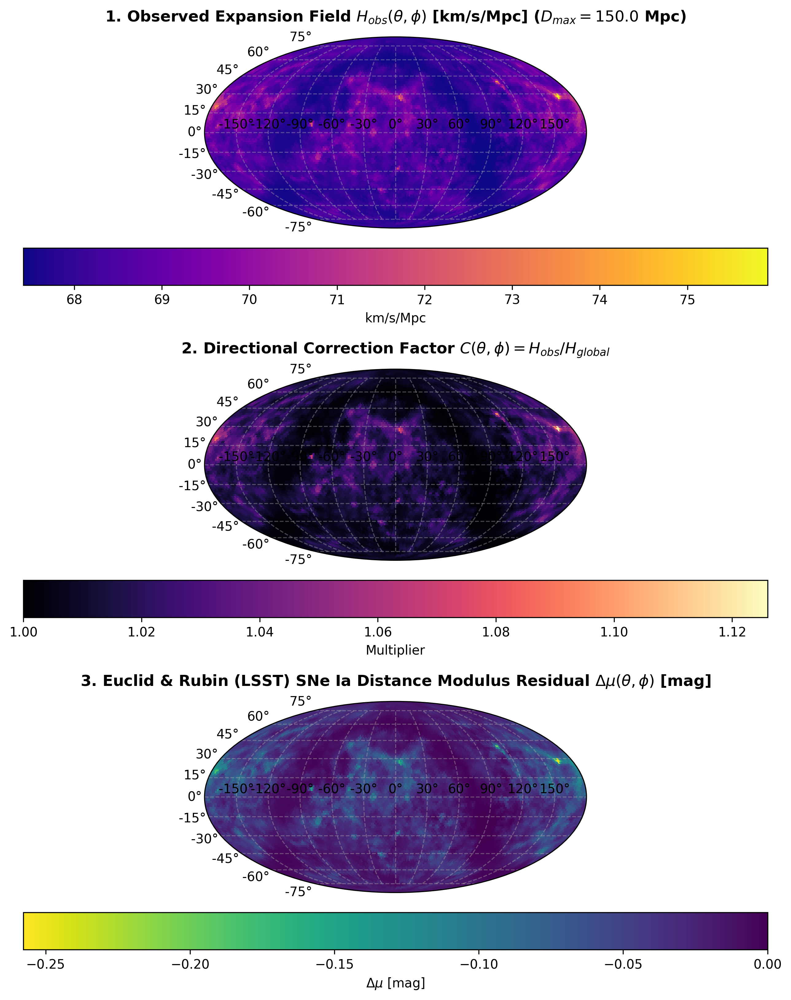 | Full-sky $H_0(\hat{n})$ unspooling maps and Euclid/LSST distance modulus anomaly forecasts $\Delta \mu(\hat{n})$. | [Read Documentation](documentation/readme_substrate_directional_correction_field.md) |
| **Line-of-Sight Kinematics** | 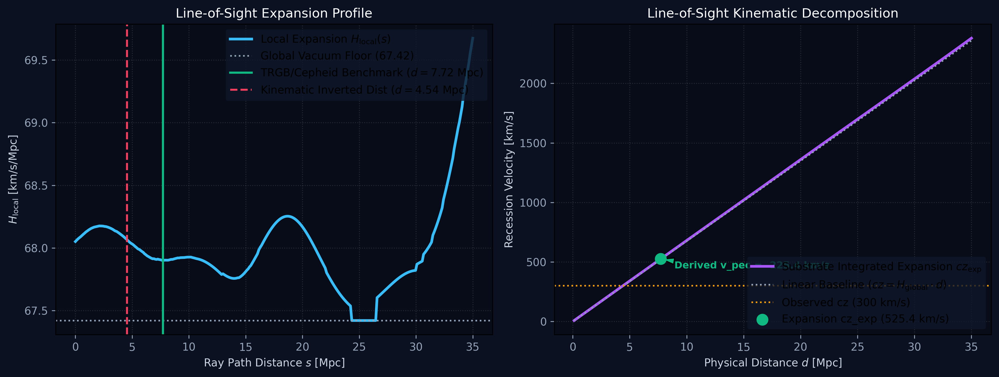 | Decouples pure cosmological expansion ($cz_{\text{exp}}$) from peculiar velocity ($v_{\text{pec}}$) along TRGB/Cepheid target paths. | [Read Documentation](documentation/readme_line_of_sight_kinematics.md) |
| **Redshift Path Integral** | 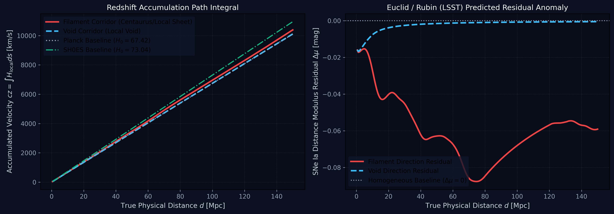 | Integrates redshift accumulation through dense filament corridors versus empty void sightlines. | [Read Documentation](documentation/readme_redshift_path_integral.md) |
| **Supernova Fit ($\Omega_\Lambda = 0$)** | 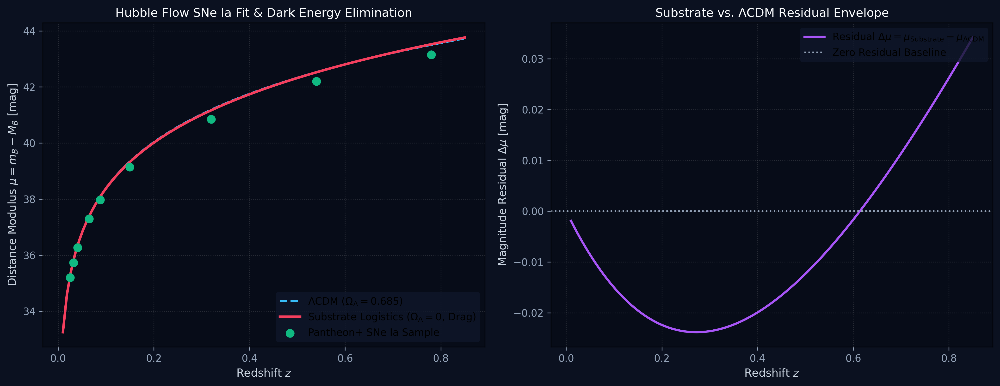 | Eliminates Dark Energy ($\Omega_\Lambda = 0$), reproducing Pantheon+ high-<i>z</i> dimming via photon memory drag attenuation. | [Read Documentation](documentation/readme_substrate_hubble_diagram_fitter.md) |
| **KBC Supervoid Profile** | 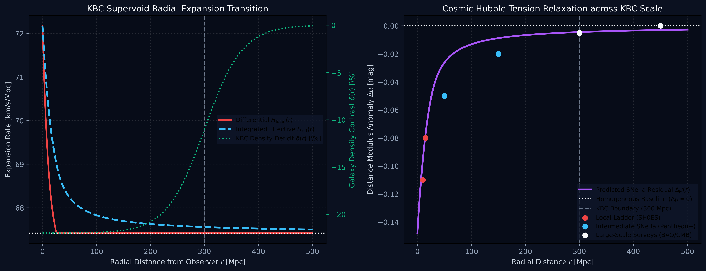 | Models radial expansion relaxation from local filament cores ($73\text{ km/s/Mpc}$) down to the global floor ($67.4275\text{ km/s/Mpc}$). | [Read Documentation](documentation/readme_substrate_kbc_void_profile.md) |

---

### Domain 2: Cosmic Web & Velocity Dynamics
Focuses on spatial velocity gradients, void wall dynamics, 2D RSD correlations, rotation curves, 3D web rendering, and 3D Dark Energy field theory.

| Module | Visual Diagnostic Preview | Physical Principle & Highlights | Detailed Docs |
| :--- | :--- | :--- | :--- |
| **Bulk Flow Field** | 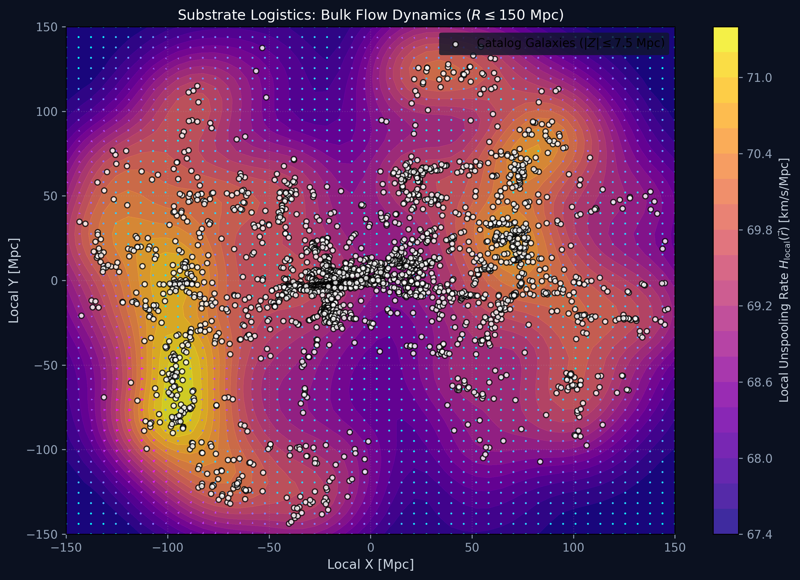 | Maps 2D spatial vector fields driven by expansion gradients <b><i>v</i></b><sub>inflow</sub> = α · ∇<i>H</i><sub>local</sub>(<b>r</b>). | [Read Documentation](documentation/readme_substrate_bulk_flow_field.md) |
| **Void Boundary Dynamics** | 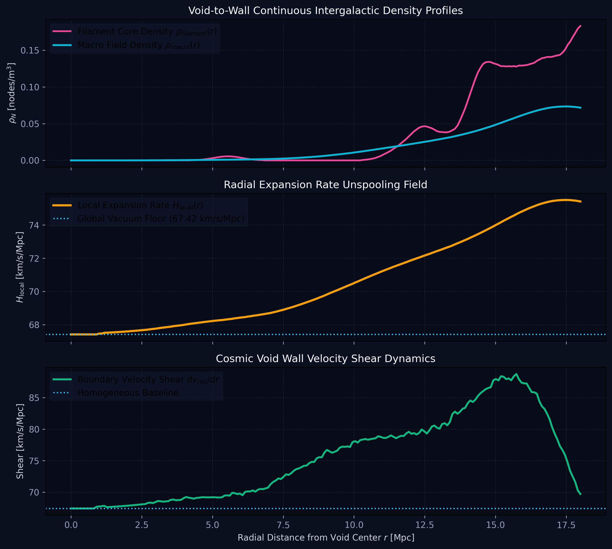 | Evaluates vacuum floor locking in void cores and velocity shear spikes ($dv_{\text{rec}}/dr$) across wall corridors. | [Read Documentation](documentation/readme_substrate_void_boundary_dynamics.md) |
| **Redshift Space Distortions** | 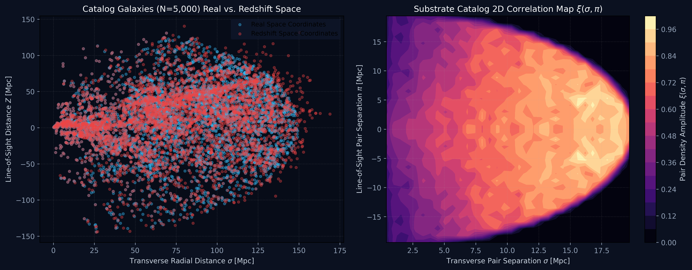 | Zero-parameter simultaneous extraction of Kaiser coherent squashing and cluster-core Fingers-of-God (FoG) elongation. | [Read Documentation](documentation/readme_substrate_redshift_space_distortions.md) |
| **Galactic Rotation Curves** | 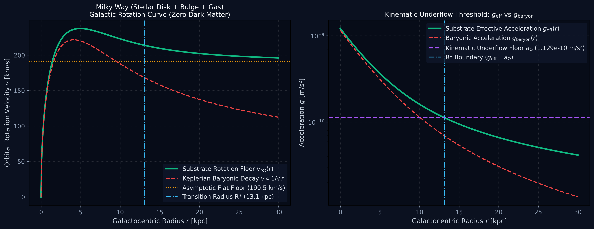 | Eradicates Dark Matter halos via Freeman (1970) thin disk & spherical profiles, the 3.8291 <i>R</i><sub>d</sub> truncation cliff, and flat floor $`v_{\text{flat}} = \sqrt[4]{N_{\text{total}}\mathcal{K}_\Omega a_\Omega}`$. | [Read Documentation](documentation/readme_substrate_rotation_curves.md) |
| **3D Cosmic Web Viewer** | 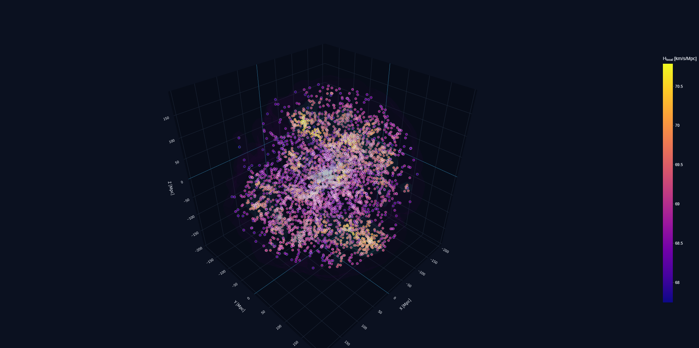 | Interactive Plotly 3D Cartesian rendering of active survey galaxies and volumetric filament web isosurfaces. | [Read Documentation](documentation/readme_substrate_3d_density_viewer.md) |
| **3D Dark Energy Field** | 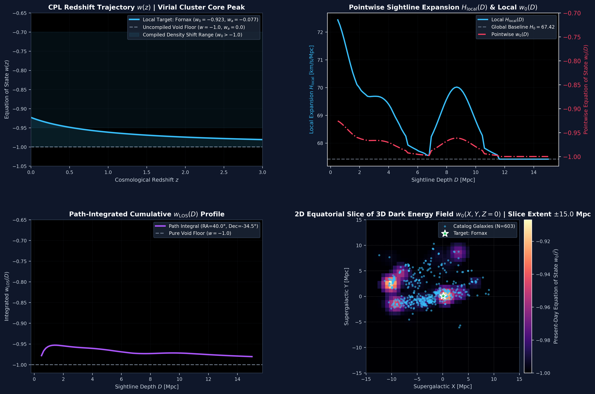 | Derives the 3D spatial Dark Energy equation of state <i>w</i><sub>0</sub>(<b>r</b>) and pointer recycling drift <i>w</i><sub>a</sub>(<b>r</b>) from compiled matter density, enforcing the cosmic sum rule <i>w</i><sub>0</sub> + <i>w</i><sub>a</sub> = -1.0. | [Read Documentation](documentation/readme_substrate_3d_dark_energy.md) |

---

### Domain 3: Astrophysical & Horizon Tests
Focuses on bare-metal geometric rulers, hybrid CMB dipole shifts, and optical light deflection.

| Module | Visual Diagnostic Preview | Physical Principle & Highlights | Detailed Docs |
| :--- | :--- | :--- | :--- |
| **BAO Ruler Warping** | 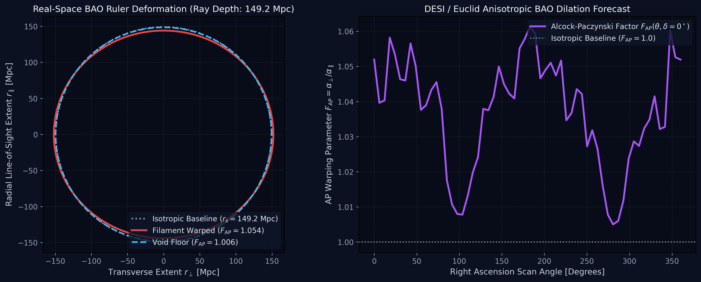 | Alcock-Paczynski anisotropic distortion of the $149.25\text{ Mpc}$ acoustic sphere across local filament structures. | [Read Documentation](documentation/readme_substrate_bao_ruler_warping.md) |
| **CMB Dipole Anomaly** | 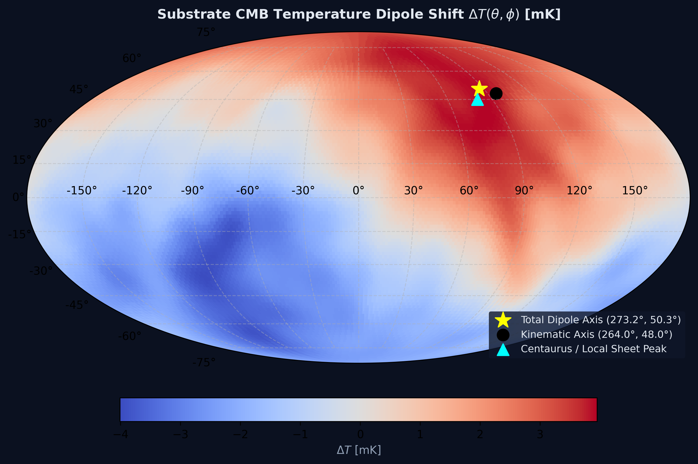 | Hybrid Solar motion + line-of-sight redshifting vector sum (J2000 Galactic-to-ICRS aligned), shifting the observable dipole axis toward Centaurus. | [Read Documentation](documentation/readme_substrate_cmb_dipole_anomaly.md) |
| **Gravitational Lensing** | 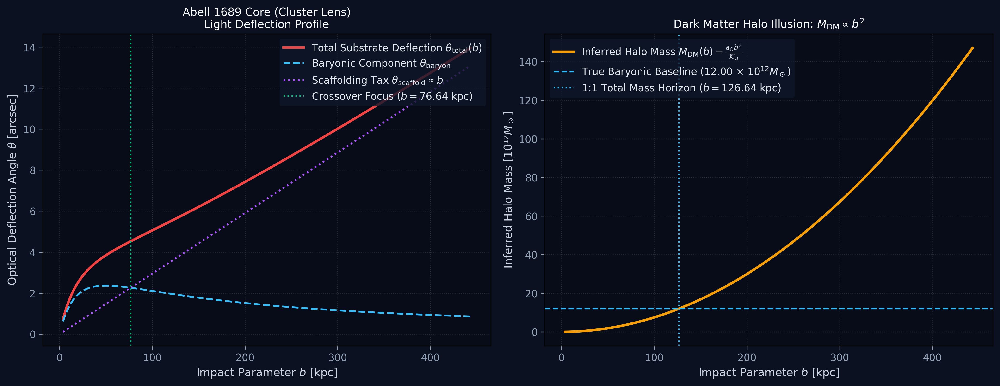 | Zero-dark-matter light deflection separating $1/b$ baryonic address deletion from the linear unspooling tax $4 a_\Omega b / c^2$ and $(1-b) = 0.8203$ cluster bias. | [Read Documentation](documentation/readme_substrate_galactic_lensing.md) |
| **$S_8$ Weak Lensing Tension** | 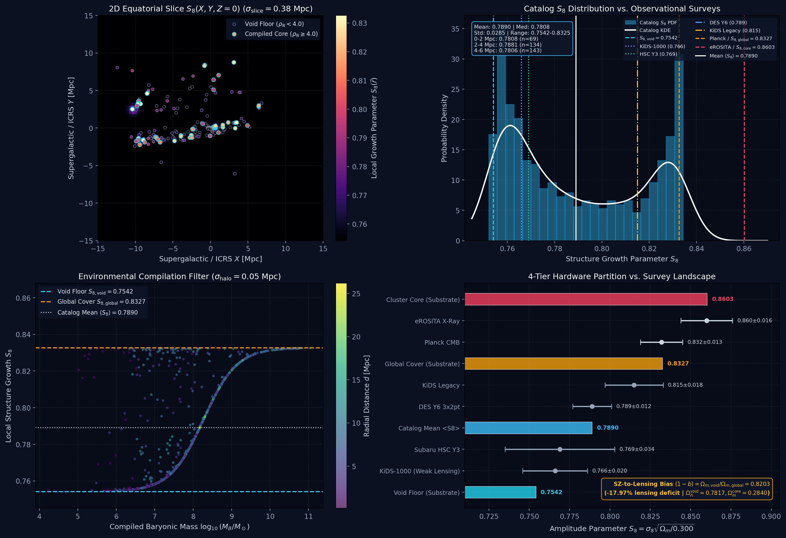 | Resolves the weak lensing vs. Planck tension via the $\rho_N \ge 4.0$ compilation filter: $`S_{8,\text{void}} = 0.7542`$, $`S_{8,\text{global}} = 0.8327`$, $`S_{8,\text{core}} = 0.8603`$, and $(1-b)=0.8203$ bias. | [Read Documentation](documentation/readme_substrate_s8_tension.md) |

---

### Domain 4: Master Regulatory Protocol & Bandwidth Allocation
Focuses on spatial memory management, coordinate deletion rates, hardware clock throttling, and universal pressure boundaries.

| Module | Visual Diagnostic Preview | Physical Principle & Highlights | Detailed Docs |
| :--- | :--- | :--- | :--- |
| **Spatial Garbage Collection** | 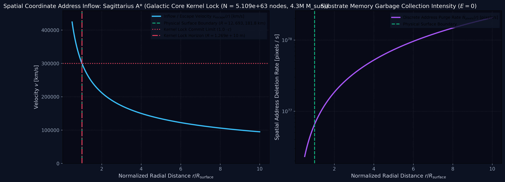 | Reclassifies gravity as $E=0$ spatial address deletion ($\dot{N}_{\text{pixels}}$), evaluating escape inflow, $R_{\text{quantum}}$, magnetospheric shells, and $1.0c$ Kernel Lock flushes. | [Read Documentation](documentation/readme_spatial_garbage_collection_engine.md) |
| **CPU Bandwidth Throttling** | 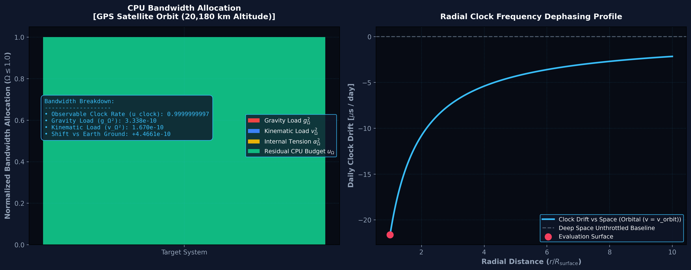 | Explains gravitational time dilation as metric processing latency under the Pythagorean bandwidth invariant ($c^2 = v^2 + u^2$). | [Read Documentation](documentation/readme_cpu_bandwidth_throttling.md) |
| **Topological Drag Pressure Floor ($P_\delta$)** | 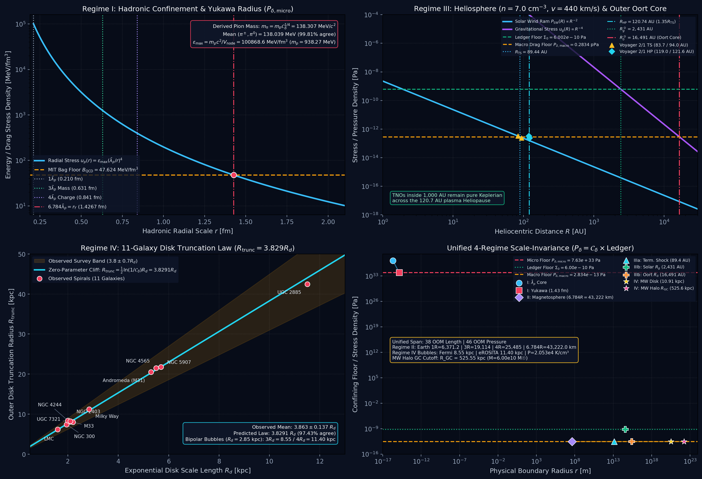 | 4-regime scale invariance spanning 38 orders of magnitude: MIT Bag / pion ($47.624\text{ MeV/fm}^3$, $138.31\text{ MeV}$), magnetospheres ($6.784R$), heliosphere ($89.44/120.74\text{ AU}$), $3.8291 R_d$ disk cliffs, and $R_{\text{GC}}$. | [Read Documentation](documentation/readme_substrate_topological_drag_floor.md) |

---

## 👤 Author & Citation

**Marco Lindenbeck**  
ORCID: [0009-0003-8413-6027](https://orcid.org/0009-0003-8413-6027)  
Repository: [LoopBreacher/substrate_logistics_cosmological_dashboard](https://github.com/LoopBreacher/substrate_logistics_cosmological_dashboard)

If you use this software or framework in your research, please cite:

```bibtex
@software{lindenbeck2026substrate,
  author    = {Lindenbeck, Marco},
  title     = {Substrate Logistics: Cosmological Engine \& Observatory},
  year      = {2026},
  publisher = {GitHub},
  url       = {https://github.com/LoopBreacher/substrate_logistics_cosmological_dashboard}
}
```

---

## Theoretical Foundation & Citations

This cosmological simulation engine and observatory is grounded in the **Substrate Logistics** theoretical manuscripts by **Marco Lindenbeck** ([ORCID: 0009-0003-8413-6027](https://orcid.org/0009-0003-8413-6027)):

1. **Lindenbeck, M. (2026).** *Substrate Logistics: The Master Regulatory Protocol.* Zenodo. [](https://doi.org/10.5281/zenodo.22127234)
2. **Lindenbeck, M. (2026).** *Substrate Logistics: The Garbage Collection Threshold.* Zenodo. [](https://doi.org/10.5281/zenodo.22774810)
3. **Lindenbeck, M. (2026).** *Substrate Logistics: The* $`S_8`$ *Weak Lensing Tension.* Zenodo. [](https://doi.org/10.5281/zenodo.23476628)
4. **Lindenbeck, M. (2026).** *Substrate Logistics: The Topological Drag Pressure Floor* ($`P_\delta`$). Zenodo. [](https://doi.org/10.5281/zenodo.24042263)
5. **Lindenbeck, M. (2026).** *Substrate Logistics: A Synthesis of the Universal Attenuation Tensor ($\mathcal{T}_\Omega$) from First Principles.* Zenodo. [](https://doi.org/10.5281/zenodo.22738464)

### BibTeX
```bibtex
@paper{lindenbeck_2026_22127234,
  author       = {Lindenbeck, Marco},
  title        = {Substrate Logistics: The Master Regulatory Protocol},
  month        = aug,
  year         = 2026,
  publisher    = {Lindenbeck, Marco},
  doi          = {10.5281/zenodo.22127234},
  url          = {https://doi.org/10.5281/zenodo.22127234},
}

@paper{lindenbeck_2026_22774810,
  author       = {Lindenbeck, Marco},
  title        = {Substrate Logistics: The Garbage Collection Threshold},
  month        = sep,
  year         = 2026,
  publisher    = {Lindenbeck, Marco},
  doi          = {10.5281/zenodo.22774810},
  url          = {https://doi.org/10.5281/zenodo.22774810},
}

@paper{lindenbeck_2026_23476628,
  author       = {Lindenbeck, Marco},
  title        = {Substrate Logistics: The $S_8$ Weak Lensing Tension},
  month        = oct,
  year         = 2026,
  publisher    = {Lindenbeck, Marco},
  doi          = {10.5281/zenodo.23476628},
  url          = {https://doi.org/10.5281/zenodo.23476628},
}

@paper{lindenbeck_2026_24042263,
  author       = {Lindenbeck, Marco},
  title        = {Substrate Logistics: The Topological Drag Pressure Floor ($P_\delta$) — Scale-Invariant Boundary Mechanics Across 38 Orders of Magnitude: Deriving the QCD Bag Constant, the 138.3 MeV Pion Mass, the 120.7 AU Heliopause, and the 3.83 R_d Galactic Disk Truncation Law},
  month        = nov,
  year         = 2026,
  publisher    = {Lindenbeck, Marco},
  doi          = {10.5281/zenodo.24042263},
  url          = {https://doi.org/10.5281/zenodo.24042263},
}

@paper{lindenbeck_2026_22738464,
  author       = {Lindenbeck, Marco},
  title        = {Substrate Logistics: A Synthesis of the Universal Attenuation Tensor ($\mathcal{T}_\Omega$) from First Principles},
  month        = sep,
  year         = 2026,
  publisher    = {Lindenbeck, Marco},
  doi          = {10.5281/zenodo.22738464},
  url          = {https://doi.org/10.5281/zenodo.22738464},
}
```

---

## 🧪 Verification Benchmark & CLI

Run the headless 18-module verification harness directly from the repository root using [`tools/benchmark_dashboard.py`](tools/benchmark_dashboard.py):

```bash
python tools/benchmark_dashboard.py
```

This benchmark validates:
1. Exact closed-form first-principles constants derived in [`modules/data_loader.py`](modules/data_loader.py) without CODATA $G$.
2. Orthogonal J2000 Galactic-to-ICRS sky coordinate alignment (`R_GAL_TO_ICRS`) verified against `astropy.coordinates.SkyCoord` (`< 1e-14` error).
3. Headless execution across all **18 computational modules** (with real local catalog caches or deterministic fallback), verifying non-empty output tables, zero `NaN`/`Inf` numeric values, and clean Matplotlib renders alongside physics regression checks.

---

## 🤝 Development Methodology & AI Collaboration Disclosure

* **Theoretical Physics & Equations:** All first-principles cosmological equations, 120-cell hardware partitions, algebraic invariants, and falsifiable astrophysical benchmarks in this repository originate from the **Substrate Logistics** research program by **Marco Lindenbeck**.
* **Software Engineering & AI Assistance:** Generative AI coding tools were utilized strictly as software engineering assistants for vectorized NumPy/`cKDTree` optimization, Matplotlib dark-theme visualization layout, Streamlit UI scaffolding, headless benchmark test wiring, and Markdown documentation formatting under direct human verification.

---

## 📜 License

This project is licensed under the MIT License - see the [LICENSE](LICENSE) file for details.