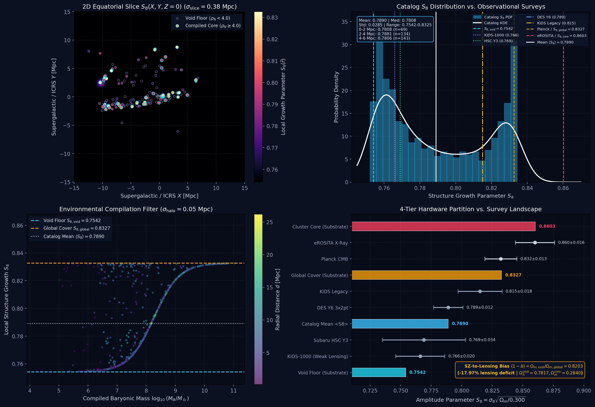
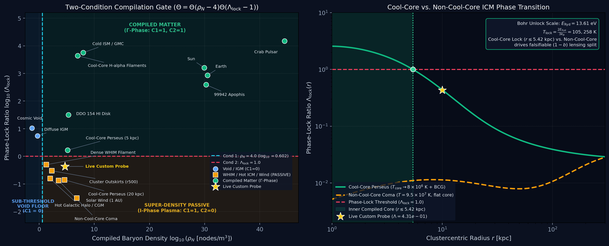

# S8 Weak Lensing Tension & Environmental Structure Growth

## 🌟 Executive Summary

The `substrate_s8_tension` module resolves the cosmological $S_8$ weak-lensing tension ($S_8 \approx 0.76\text{--}0.77$ from cosmic shear surveys vs. $S_8 \approx 0.832$ from Planck CMB) as a direct environmental consequence of the **120-cell Two-Condition Compilation Gate**: density threshold $\rho_{\text{GC}} = 4.0\text{ nodes/m}^3$ combined with the zero-parameter **Absolute Bandwidth Phase-Lock Criterion** $\Lambda_{\text{lock}} \ge 1.0$. The module contains two coupled observatories (`run_s8_tension_analysis` and `run_two_condition_phase_audit`): evaluating dynamic local matter partitions $\Omega_m(\vec{r})$ and structure growth amplitudes $S_8(\vec{r})$ across active multi-band catalogs, and mapping compiled $\Gamma$-phase matter vs. passive $I$-phase plasma (WHIM filaments, Non-Cool-Core Coma, Solar Wind) across 16 astrophysical regimes.

---

## 🔬 Physical Foundation & First Principles

### 1. 120-Cell Zero-Sum Matter Partitions

Derived directly from Poincaré 120-cell geometry ($\kappa = 50$, routing scalar `1.2`, exact algebraic drag coefficient $\mathcal{C}_\delta = (\sqrt{5}-2)/500 = 4.72136 \times 10^{-4}$):

* **Uncompiled Void Floor ($\Omega_{m,\text{void}}, S_{8,\text{void}}$):**

$$\Omega_{m,\text{void}} = \frac{12}{50} - \sqrt{\mathcal{C}_\delta} = 0.218271, \quad \Omega_{\Lambda,\text{void}} = 1 - \Omega_{m,\text{void}} = 0.781729$$

$$S_{8,\text{void}} = \sqrt{\Omega_{\Lambda,\text{void}}} \sqrt{\frac{\Omega_{m,\text{void}}}{0.300}} = 0.7542$$

* **Global Compiled Baseline ($\Omega_{m,\text{global}}, S_{8,\text{global}}$):**

$$\Omega_{m,\text{global}} = \frac{12}{50} + 1.2\sqrt{\mathcal{C}_\delta} = 0.266074, \quad S_{8,\text{global}} = 0.8327$$

* **Cluster Core Saturation ($\Omega_{m,\text{core}}, S_{8,\text{core}}$):**

$$\Omega_{m,\text{core}} = 0.2840 \implies S_{8,\text{core}} = 0.8603$$

### 2. Compilation Activation Filter & Cluster Mass Bias

* **Local Activation Fraction ($\theta_{\text{act}}$):**
  * *Smooth Volume Fraction:* $\theta_{\text{act}}(\vec{r}) = \frac{\rho_N(\vec{r})}{\rho_N(\vec{r}) + \rho_{\text{GC,exact}}}$
  * *Strict Heaviside Switch:* $\theta_{\text{act}}(\vec{r}) = \Theta(\rho_N(\vec{r}) - 4.0)$
* **SZ-to-Lensing Hydrostatic Cluster Bias ($1 - b$):**

$$1 - b = \frac{\Omega_{m,\text{void}}}{\Omega_{m,\text{global}}} = 0.8203 \quad (-17.97\% \text{ lensing mass deficit})$$

### 3. Zero-Parameter Two-Condition Compilation Gate (`evaluate_two_condition_compilation_gate`)

Baryonic gas/matter transitions into active $\Gamma$-phase compiled nodes ($\Theta_{\text{compiled}} = 1$) if and only if both the spatial Garbage-Collection ceiling **and** the Absolute Bandwidth Phase-Lock condition are satisfied:

$$\Theta_{\text{compiled}} = \Theta(\rho_N - 4.0) \cdot \Theta(\Lambda_{\text{lock}} - 1.0), \quad \Lambda_{\text{lock}} = \frac{g_{\text{river}}^2 + g_{\text{EM}}^2}{v_{\text{th}}^2 + v_{\text{bulk}}^2}$$

where $g_{\text{river}}^2 = \frac{2 N_{\text{enc}} \mathcal{K}_\Omega}{R c^2}$, $g_{\text{EM}}^2 = \frac{2 E_{\text{Ryd}}}{\mu m_p c^2}$, and all electromagnetic phase-lock constants are derived without free parameters from $\alpha^{-1} = 137.035999084$ and $m_p/m_e = 1836.15267343$:

$$E_{\text{Ryd}} = \frac{m_p c^2}{2 (m_p/m_e) (\alpha^{-1})^2} = 13.6057\text{ eV} \implies T_{\text{lock}} = \frac{2 E_{\text{Ryd}}}{3 k_B} = 105,258\text{ K}$$

* **Multi-Band Catalog Impact (`UNG 2013` & `Cosmicflows-4`):** Switching from legacy constant $M/L_B = 0.44$ to the `v2` Multi-Band pipeline (`100% K-band` on `UNG 2013`; `27% WISE W1 | 73% Fallback` on `Cosmicflows-4`) shifts catalog $\langle S_8 \rangle$ from `0.7796` → `0.7890` (`UNG 2013`) and `0.8317` → `0.8313` (`Cosmicflows-4`).

---

## 📊 Visual Diagnostic Walkthrough

### Tab A — 3D Catalog $S_8$ Field (`run_s8_tension_analysis`)

1. **Top-Left — 2D Equatorial Slice ($Z = 0$):** Renders continuous $S_8(X, Y, Z=0)$ contours bounded between $S_{8,\text{void}} = 0.7542$ and $S_{8,\text{global}} = 0.8327$, highlighting compiled core galaxies ($\rho_N \ge 4.0$).
2. **Top-Right — Catalog PDF & 2026 Survey Benchmarks:** Overlays the Multi-Band (`v2`) catalog $S_8$ distribution against KiDS-1000 (`0.766`), Subaru HSC Y3 (`0.769`), DES Y6 (`0.789`), KiDS Legacy (`0.815`), Planck CMB (`0.832`), and eROSITA X-Ray (`0.860`).
3. **Bottom-Left — Mass-Environment Scaling:** Plots $\log_{10}(M_B/M_\odot)$ against local $S_8$, showing dwarf voids locked onto $0.7542$ while massive compiled systems climb toward $0.8327$.
4. **Bottom-Right — 4-Tier Partition & Cluster Bias:** Contrasts all four Substrate hardware partitions directly against weak-lensing, CMB, and X-ray survey error bars with the zero-parameter $(1-b) = 0.8203$ bias badge.

### Tab B — Two-Condition Compilation Gate & Cool-Core ICM (`run_two_condition_phase_audit`)

1. **Left — 4-Quadrant Compilation Phase Diagram ($\log_{10}\rho_N$ vs. $\log_{10}\Lambda_{\text{lock}}$):**
   * **Sub-Threshold Void Floor (`C1 = 0`, `PASSIVE`):** `Cosmic Void`, `Diffuse IGM`.
   * **Super-Density Passive $I$-Phase Plasma (`C1 = 1, C2 = 0`, `PASSIVE`):** `Dense WHIM Filament`, `Cluster Outskirts (r500)`, `Hot Galactic Halo / CGM`, `Non-Cool-Core Coma`, `Cool-Core Perseus (20 kpc)`, and outbound `Solar Wind (1 AU)` ($v_{\text{bulk}} = 440\text{ km/s}$).
   * **Compiled $\Gamma$-Phase Matter (`C1 = 1, C2 = 1`, `COMPILED`):** `Cool-Core Perseus (5 kpc)`, `Cool-Core H-alpha Filaments`, `DDO 154 HI Disk`, `Cold ISM / GMC`, `99942 Apophis`, `Earth`, `Sun`, and `Crab Pulsar`.
2. **Right — Cool-Core vs. Non-Cool-Core ICM Radial Transition ($\Lambda_{\text{lock}}(r)$, `1–300 kpc`):** Demonstrates Cool-Core Perseus crossing into the compiled $\Gamma$-phase inside $r_{\text{lock}} = 5.42\text{ kpc}$ near its central BCG, whereas hot Non-Cool-Core Coma remains strictly passive ($\Lambda_{\text{lock}} < 0.03$) everywhere — yielding a falsifiable $(1-b)$ lensing split between relaxed cool-core and merging non-cool-core clusters.

---

## 🎯 KPI Metrics & Export Deliverables

### Tab A (`substrate_s8_weak_lensing_field.csv`)

| Metric Key | Format / Benchmark | Physical Meaning |
| :--- | :--- | :--- |
| `Void Floor (S8_void)` | `0.7542` | Bare uncompiled void structure growth limit $`S_{8,\text{void}}`$. |
| `Catalog Mean <S8>` | Float (`.4f`) | Mean $`\langle S_8 \rangle`$ across evaluated survey galaxies (`0.7890` UNG `v2`, `0.8313` CF4 `v2`). |
| `Global Baseline (S8_global)` | `0.8327` | Compiled full-cover amplitude $`S_{8,\text{global}}`$ matching Planck CMB. |
| `Cluster Core (S8_core)` | `0.8603` | Saturated cluster core amplitude $`S_{8,\text{core}}`$ matching eROSITA X-Ray. |
| `SZ-Lensing Bias (1 - b)` | `0.8203 (-17.97%)` | Zero-parameter hydrostatic bias ratio $`\Omega_{m,\text{void}} / \Omega_{m,\text{global}}`$. |

* **CSV Columns:** `galaxy_name`, `distance_mpc`, `baryonic_mass_solar`, `rho_N_nodes_m3`, `theta_activation`, `omega_m_local`, `S8_local`.

### Tab B (`substrate_two_condition_phase_gate.csv`)

| Metric Key | Format / Benchmark | Physical Meaning |
| :--- | :--- | :--- |
| `Bohr Unlock Temp (T_lock)` | `105,258 K (13.61 eV)` | Electromagnetic phase-lock thermal limit derived from $`E_{\text{Ryd}}`$. |
| `Benchmarks Compiled` | `8 / 16 Regimes` | Verified count passing both `C1` and `C2` (`8 PASSIVE / 8 COMPILED`). |
| `Cool-Core Crossover (r_lock)` | `5.42 kpc (Perseus)` | Inner cluster radius where Perseus ICM crosses $`\Lambda_{\text{lock}} \ge 1.0`$. |
| `Custom Probe Λ_lock` | Scientific (`.3e`) | Live user-configured parcel phase-lock ratio $`\Lambda_{\text{lock}}`$. |
| `Custom Gate Verdict` | `COMPILED` / `PASSIVE` | Active compilation gate state ($\Gamma$-Phase vs. $I$-Phase). |

* **CSV Columns:** `Regime`, `rho_N_nodes_m3`, `T_K`, `r_grav`, `r_em`, `Lambda_lock`, `Cond1_rho>=4`, `Cond2_Lock>=1`, `Verdict`.
