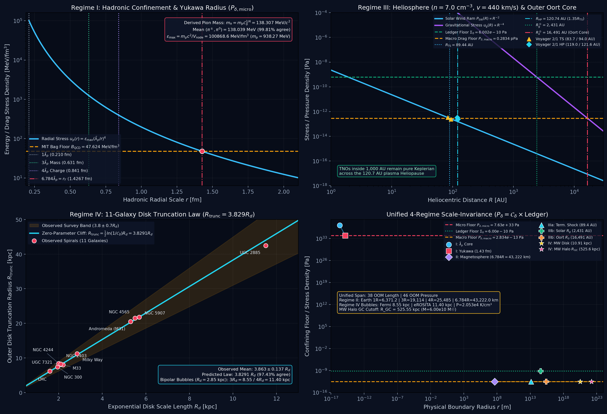

# Topological Drag Pressure Floor (P_δ): 4-Regime Observatory

## 🌟 Executive Summary

The `substrate_topological_drag_floor` module unifies confinement and outer boundary mechanics across **38 orders of magnitude in length** and **46 orders of magnitude in pressure** using a single algebraic topological drag factor $\mathcal{C}_\delta = (\sqrt{5}-2)/500 = 4.72136 \times 10^{-4}$ applied to the microscopic and macroscopic Hardware Energy Ledgers ($\epsilon_{\max}, \Sigma_0$).

---

## 🔬 Physical Foundation Across 4 Regimes

### 1. Micro & Macro Drag Pressure Floors

$$P_{\delta,\text{micro}} = \mathcal{C}_\delta \epsilon_{\max} = 7.6302 \times 10^{33}\text{ Pa} \equiv 47.624\text{ MeV/fm}^3 \quad (B_{\text{QCD}})$$

$$P_{\delta,\text{macro}} = \mathcal{C}_\delta \Sigma_0 = 2.8339 \times 10^{-13}\text{ Pa} \equiv 0.2834\text{ pPa} \quad \left(\frac{P_\delta}{k_B} = 2.0526 \times 10^4\text{ K cm}^{-3}\right)$$

### 2. Four Scale-Invariant Boundary Laws

* **Regime I (Hadronic Confinement):** Radial proton stress $u_p(r) = \epsilon_{\max}(\bar{\lambda}_p/r)^4$ meets $P_{\delta,\text{micro}}$ at the Yukawa radius $r_Y = \mathcal{C}_\delta^{-1/4}\bar{\lambda}_p = 6.784\bar{\lambda}_p = 1.4267\text{ fm}$, yielding $m_\pi = m_p \mathcal{C}_\delta^{1/4} = 138.307\text{ MeV}/c^2$ ($99.81\%$ match to observed $(\pi^\pm,\pi^0)$ mean).
* **Regime II (Planetary Magnetospheres):** Scales core radius boundaries to $3R$ (Plasmapause), $4R$ (Van Allen inner edge), and $6.784R$ (Ring-current stagnation limit, $43,222.0\text{ km}$ at Earth, McIlwain $L = 6.784$).
* **Regime III (Heliosphere & Outer Oort Core):** Live Solar wind ram pressure hits $P_{\delta,\text{macro}}$ at $R_{\text{TS}} = 89.44\text{ AU}$ and Heliopause $R_{\text{HP}} = 1.35 R_{\text{TS}} = 120.74\text{ AU}$ (matching Voyager 1 & 2 crossings), while Solar gravitational stress remains strictly Keplerian inside $R_g^\odot = 2,430.8\text{ AU}$ and $R_\delta^\odot = 16,490.6\text{ AU}$.
* **Regime IV (Galactic Disk Truncations & Halo Cutoff):** Predicts exponential disk cutoffs across 11 benchmark spirals via $R_{\text{trunc}} = \frac{1}{2}\ln(1/\mathcal{C}_\delta)R_d = 3.8291 R_d$, Fermi ($3R_d = 8.55\text{ kpc}$) & eROSITA ($4R_d = 11.40\text{ kpc}$) nuclear bubbles, and the exact circumgalactic Garbage-Collection halo cutoff:

$$R_{\text{GC}} = \left(\frac{3 M}{4\pi \rho_{\text{Ledger}}}\right)^{1/3} = 525.55\text{ kpc} \quad \left(M = 6.0 \times 10^{10} M_\odot\right)$$

---

## 📊 Visual Diagnostic Walkthrough

1. **Top-Left — Regime I (Hadronic):** Plots $u_p(r)$ crossing the $47.624\text{ MeV/fm}^3$ MIT Bag Floor at $1.4267\text{ fm}$ alongside $1, 3, 4, 6.784\,\bar{\lambda}_p$ markers.
2. **Top-Right — Regime III (Heliosphere & Oort Core):** Contrasts $R^{-2}$ Solar wind plasma ram pressure (Voyager crossings) against $R^{-4}$ gravitational deletion stress down to $R_\delta^\odot = 16,491\text{ AU}$.
3. **Bottom-Left — Regime IV (11-Galaxy Disk Benchmark):** Validates $R_{\text{trunc}} = 3.8291 R_d$ across 11 spirals from `UGC 7321` to `UGC 2885`.
4. **Bottom-Right — Unified 4-Regime Map:** Maps all four regimes across 38 orders of magnitude in radius and 46 orders of magnitude in pressure.

---

## 🎯 KPI Metrics & Export Deliverables

| Metric Key | Default Value | Physical Meaning |
| :--- | :--- | :--- |
| `MIT Bag Floor (B_QCD)` | `47.62 MeV/fm³` | Microscopic pressure floor $`P_{\delta,\text{micro}} = \mathcal{C}_\delta \epsilon_{\max}`$. |
| `Derived Pion / Yukawa` | `138.31 MeV \| 1.427 fm` | Exact first-principles pion mass and confinement radius $`r_Y`$. |
| `Macro Drag Floor (P_δ)` | `0.2834 pPa` | Cosmic hardware drag pressure floor $`\mathcal{C}_\delta \Sigma_0`$. |
| `Shock / Heliopause` | `89.44 / 120.74 AU` | Termination shock $`R_{\text{TS}}`$ and heliopause $`R_{\text{HP}} = 1.35 R_{\text{TS}}`$. |
| `Disk Cliff / Bubbles` | `3.829 R_d \| 8.55/11.40 kpc` | Exponential disk cliff multiple and Fermi/eROSITA nuclear bubble heights. |

* **CSV Export Schema (`substrate_topological_drag_pressure_floor.csv`):**
  * `Regime`, `System`, `Scale_Anchor`, `Substrate_Predicted`, `Observed_Benchmark`, `Units`, `Notes`.
